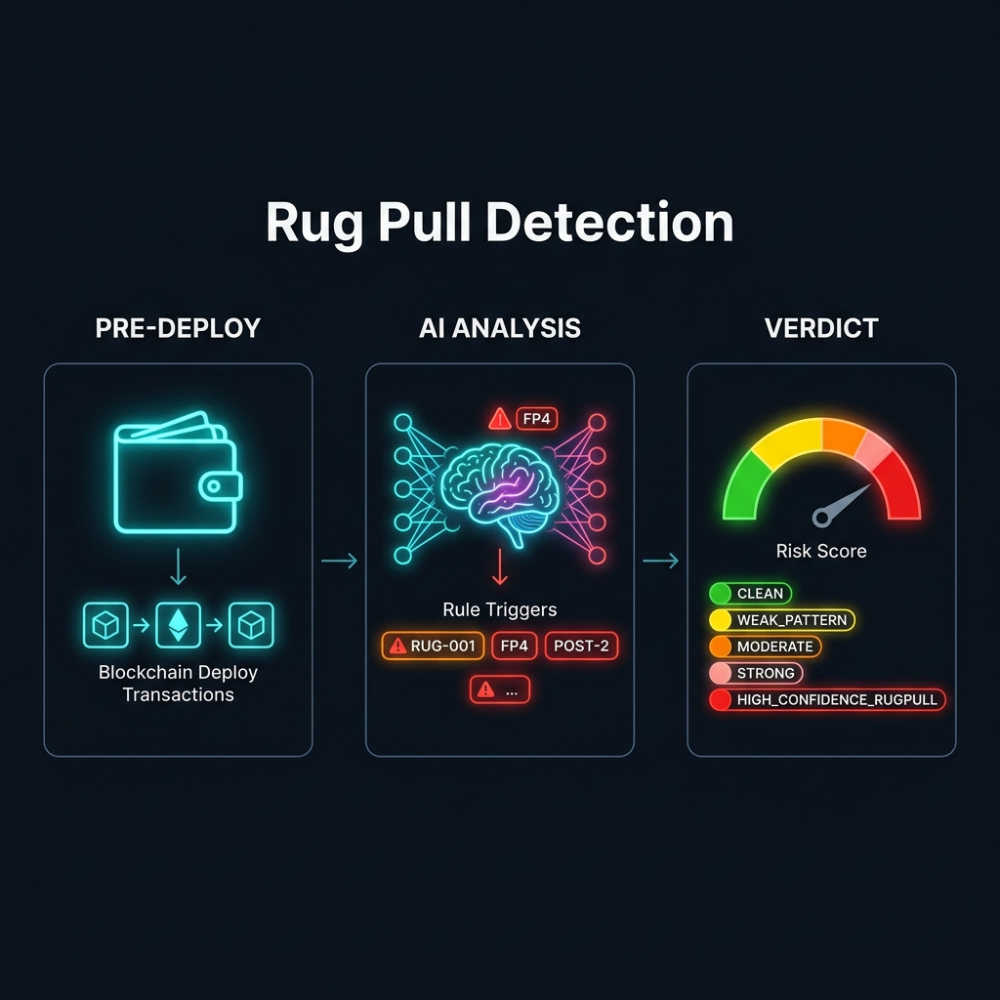
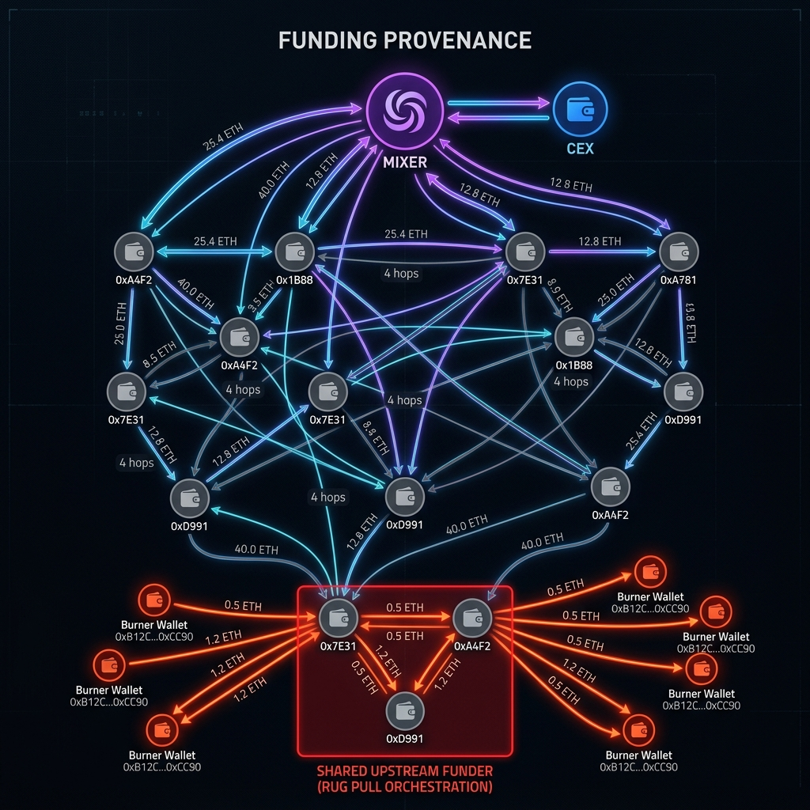
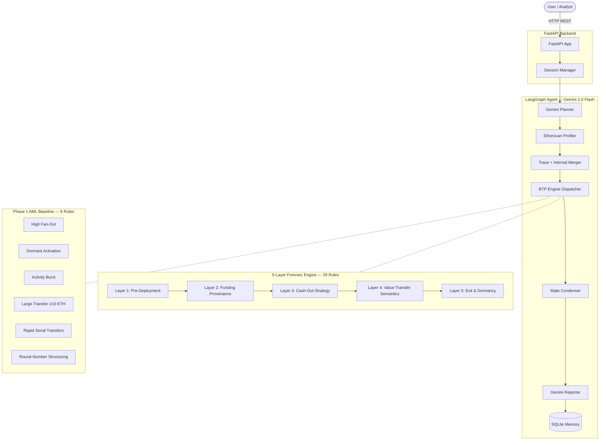

<div align="center">


<br/>

# 🕵️ Single-Agent Blockchain Investigator

### *Lifecycle-Aware Behavioral Threat Profiling for Ethereum Rugpull Deployers*

<br/>

[](https://python.org)
[](https://fastapi.tiangolo.com)
[](https://langchain-ai.github.io/langgraph/)
[](https://deepmind.google/technologies/gemini/)
[](LICENCE)
[](Dockerfile)

<br/>

> **Autonomous. Deterministic. Explainable.**
> An AI forensic agent that hunts rugpull deployers by their *full behavioral lifecycle* — funding origin, deployment patterns, cash-out mechanics, scripting fingerprints, and dormancy cycles — long before a liquidity pool is drained.

<br/>

[🚀 Quick Start](#-quick-start) · [🧠 How It Works](#-how-it-works) · [⚖️ Detection Rules](#️-the-29-rule-detection-engine) · [📊 Results](#-empirical-results) · [🏗️ Architecture](#️-architecture) · [🔬 Research Tools](#-research--benchmarking-tools) · [📄 UGRC Report](#-ugrc-research-report)

</div>

---

## 💥 The Problem

DeFi rugpulls drained an estimated **\$2.8 billion** between 2021 and 2023. Traditional on-chain tracers only act *after* the drain — when the money is already gone, routed through mixers, and the deployer has vanished into dormancy.

**This project flips the model.**

Instead of tracing the crime after the fact, the system profiles the *deployer* across their full operational lifecycle — from initial wallet creation and seed funding, through contract deployment, liquidity extraction, and post-exploit dormancy. The result is a **29-rule deterministic forensic engine** that flags **93.3% of confirmed rugpull creators** with no machine learning, and classifies **67.8% of them before the first drain event** using only pre-exploit preparation and funding provenance signals.

---

## 🧠 How It Works

<div align="center">

</div>

<br/>

The system operates across **five sequential forensic layers** spanning the complete temporal lifecycle of a rugpull campaign:

### Layer 1 — Pre-Deployment Behavioral Dynamics
Examines the creator wallet between initial funding and the first contract deployment.

| Signal | Threshold | What It Catches |
|--------|-----------|-----------------|
| 🔥 **Extreme Burner Wallet** (`RUG-001`) | Wallet age < 15 min | Account created and immediately used to deploy |
| 🤖 **Scripted Funding CV** (`RUG-002`) | CV ≤ 0.9956, ≥3 inbounds | Automated, bot-driven capital injection at uniform intervals |
| 📦 **Secondary Rapid Deployment** (`RUG-NEW-A`) | 2nd contract < 60 min after 1st | Auxiliary locker/router contract deployed alongside primary scam |
| 🔑 **Rapid Ownership Transfer** (`RUG-NEW-B`) | Renounce within 48h | Fake decentralization to obscure drain access |
| 🧬 **Bytecode Template Cloning** (`RUG-F7`) | Size similarity > 95% | Cloned scam contract templates reused across campaigns |

### Layer 2 — Funding Provenance and Graph Topology

<div align="center">

</div>

<br/>

Traces the upstream origin of seed capital via recursive multi-hop graph traversal to expose syndicate co-funding infrastructure:

| Rule | Signal | Trigger Rate (N=90) | Severity |
|------|--------|--------------------|----------|
| `RUG-FP4` | Mixer / Tornado Cash / bridge seed ingress | **61.1%** (55/90) | 🚨 CRITICAL +40 |
| `RUG-FP5` | Shared upstream funder across deployer wallets | **58.9%** (53/90) | 🔴 HIGH +25 |
| `RUG-FP2` | Seed capital from depth ≥ 3 proxy hops | — | 🔴 HIGH +20 |
| `RUG-FP3` | ≥ 50% seed from wallets created < 24h prior | — | 🔴 HIGH +20 |
| `RUG-FP8` | Upstream ancestor Jaccard similarity > 0.50 | — | 🔴 HIGH +20 |

> Over **58.9% of investigated rugpull wallets share a common upstream funder** with at least one other known malicious deployer, confirming organized syndicate infrastructure.

### Layer 3 — Cash-Out Strategy and Liquidity Extraction

Merges normal transactions with **internal EVM traces** (`CALL`/`DELEGATECALL`/`SELFDESTRUCT`) to capture smart-contract-mediated ETH sweeps that standard scrapers miss:

| Rule | Signal | Trigger Rate (N=90) | Severity |
|------|--------|--------------------|----------|
| `RUG-CP4` | Mule wallet fan-out: ≥10 fresh destinations | **50.0%** (45/90) | 🚨 CRITICAL +40 |
| `RUG-CP6` | AMM liquidity removal + swap within 24h | **15.6%** (14/90) | 🔴 HIGH +25 |
| `RUG-CP7` | Retained victim proceeds < 1% | **8.9%** (8/90) | 🚨 CRITICAL +40 |
| `RUG-CP2` | Treasury sweep drain ratio ≥ 90% | **5.6%** (5/90) | 🚨 CRITICAL +40 |
| `RUG-CP5` | Direct proceeds routing to mixer | **4.4%** (4/90) | 🚨 CRITICAL +40 |
| `RUG-CP3` | Fragmentation / structured layering | **0.0%** (0/90) | *Null — velocity preferred* |

> **CP3 (fragmentation/layering) registered zero triggers** — rugpull operators overwhelmingly prioritize extraction *velocity* over laundering sophistication, moving capital en masse to mule wallets before white-hat intervention.

### Layer 4 — Value-Transfer Semantics and Scripting Fingerprints

Isolates mechanical artifacts imprinted by automated deployment and extraction scripts:

| Rule | Signal | Trigger Rate (N=90) | Severity |
|------|--------|--------------------|----------|
| `RUG-VS-6` | Extraction multiplier ≥ 50× (LP drain economics) | **54.4%** (49/90) | 🚨 CRITICAL +40 |
| `RUG-VS-5` | Cross-deployment seed amount Jaccard > 0.80 | **23.3%** (21/90) | 🟡 MEDIUM +10 |
| `RUG-VS-1` | Inbound value mode frequency ≥ 60% (sybil bots) | **7.8%** (7/90) | 🔴 HIGH +20 |
| `RUG-VS-4` | Pre-cashout micro-dusting pings (≥5 within 24h) | **6.7%** (6/90) | 🔴 HIGH +20 |
| `RUG-VS-3` | Gas-price uniformity anomaly (CV < 0.05) | **1.1%** (1/90) | 🟡 MEDIUM +10 |
| `RUG-VS-2` | Round-number seed funding (mod 0.5 ETH = 0) | **0.0%** (0/90) | *Low incidence* |

### Layer 5 — Exit Dynamics and Post-Exploit Dormancy

Tracks the post-operational phase to quantify serial abuse and the "burner-phone" reactivation pattern:

| Rule | Signal | Trigger Rate (N=90) | Severity |
|------|--------|--------------------|----------|
| `RUG-EXIT-2` | Cyclical dormancy reactivation ≥ 30 days | **67.8%** (61/90) | 🚨 CRITICAL +30 |
| `EXIT-META` | Operational retirement likelihood score | **66.7%** (60/90) | INFO |

> **67.8% of confirmed rugpull operators exhibit serial cyclical reuse** — wallets are silenced after each exploit for months, then reactivated for subsequent campaigns. These are *not* single-use burner accounts.

---

## 📊 Empirical Results

Evaluated against a ground-truth cohort of **90 confirmed Ethereum rugpull creator wallets** and **18 genuine developer controls** (108 wallets total, all from publicly accessible on-chain data):

```
Overall Detection Rate (S ≥ 25):          93.3%  (84 / 90 wallets)
Pre-exploit flagging (Layers 1–2 only):   67.8%  HIGH/STRONG classification
Mixer/bridge co-funding prevalence:       61.1%  (55 / 90 wallets)
Syndicate co-funding prevalence:          58.9%  (53 / 90 wallets)
Serial dormancy-reactivation rate:        67.8%  (61 / 90 wallets)
Median composite threat score:            80.0 / 100
```

**Verdict distribution across the malicious cohort (N=90, Layers 1–2):**

```
HIGH_CONFIDENCE [███████████████████████████████████████████████████] 61.1% (55)
STRONG_PATTERN  [██████] 6.7% (6)
MODERATE_PAT.   [████] 4.4% (4)
WEAK_PATTERN    [██████████] 11.1% (10)
CLEAN           [█████████████] 14.4% (13)
INSUFFICIENT    [██] 2.2% (2)
```

**Two hypotheses empirically refuted:**
- ❌ **"Dry-run on mainnet" heuristic** — 0% of malicious wallets had pre-deploy reverted transactions. Both attackers and legitimate developers test on local forks/testnets exclusively.
- ❌ **"Deployment burstiness = malicious"** — Legitimate protocol engineers exhibit *higher* burst deployment counts (proxy + implementation + registry + governance in rapid succession). Scammers execute isolated single deployments.

---

## 📋 Verdict System

The engine outputs one of **6 structured verdicts**, each backed by a scored evidence chain:

```
╔══════════════════════════════════════════════════════════════════╗
║  VERDICT                          COLOUR    SCORE RANGE          ║
╠══════════════════════════════════════════════════════════════════╣
║  ✅ CLEAN                          GREEN     0 – 19              ║
║  ℹ️  INSUFFICIENT_HISTORY          CYAN      N/A (sparse wallet) ║
║  ⚠️  WEAK_PATTERN                  YELLOW    20 – 39             ║
║  🟠 MODERATE_PATTERN               ORANGE    40 – 59             ║
║  🔴 STRONG_PATTERN                 RED       60 – 79             ║
║  🚨 HIGH_CONFIDENCE_RUGPULL        BRIGHT RED  80+               ║
╚══════════════════════════════════════════════════════════════════╝
```

Every verdict is accompanied by a Gemini-generated **Observation → Evidence → Reasoning** narrative — fully auditable, no black boxes.

---

## 🏗️ Architecture



The pipeline runs in two modes:
- **Phase 1 (AML Baseline):** 6 general-purpose anti-money-laundering pattern rules applied to any Ethereum wallet via one-hop transaction graph analysis.
- **Phase 2 (BTP Engine):** Full 29-rule lifecycle profiling of smart contract deployer EOAs, using both normal transactions and internal EVM traces.

---

## 🚀 Quick Start

**1. Clone & Setup**
```bash
git clone https://github.com/dyno-dr/single-agent-blockchain-investigator.git
cd single-agent-blockchain-investigator
python -m venv venv
source venv/bin/activate       # Windows: venv\Scripts\activate
pip install -r requirements.txt
```

**2. Configure Environment**
```bash
cp .env.example .env
# Add your keys:
# ETHERSCAN_API_KEY=your_key_here
# GOOGLE_API_KEY=your_gemini_key_here
```

**3. Launch the Backend**
```bash
uvicorn backend.main:app --reload --host 0.0.0.0 --port 8000
```
> API docs auto-available at `http://localhost:8000/docs`

**4. Open the UI**
```
Open frontend/index.html in your browser.
No Node.js, no build step — just open and go.
```

**5. CLI — Single Address (Fastest)**
```bash
python test_rugpull.py 0xYourTargetAddress --fetch
```

**6. Batch Feature Extraction (108-wallet matrix)**
```bash
python extract_all_features_csv.py
# Outputs: full_feature_matrix.csv (108 wallets × 68 features)
```

**7. Docker (Optional)**
```bash
docker-compose up --build
```

---

## ⚖️ The 29-Rule Detection Engine

<details>
<summary><b>📋 Click to expand — Full Rule Register</b></summary>

### 🔴 Layer 1: Pre-Deployment Rules

| Rule ID | Name | Invariant / Trigger | Severity | Score |
|---------|------|---------------------|----------|-------|
| `RUG-001` | Extreme Burner Wallet | Wallet age < 15 min before deploy | CRITICAL | +40 |
| `RUG-002` | Scripted Funding Cadence | Funding CV ≤ 0.9956 with ≥3 inbounds | HIGH | +25 |
| `RUG-F3` | Mainnet Dry-Run Testing | Reverted pre-deploy txs ≥ 1 | LOW | +5 |
| `RUG-F4` | Single-Contract Deployer | \|C_W\| = 1 and age > 7d | MEDIUM | +15 |
| `RUG-F4B` | Deployment Cadence Inversion | Near-zero deployment variance | MEDIUM | +15 |
| `RUG-F5` | Low Nonce Action Entropy | Shannon entropy H < 1.0 | LOW | +5 |
| `RUG-F7` | Bytecode Template Cloning | Size similarity > 95% across deploys | HIGH | +20 |
| `RUG-NEW-A` | Rapid Auxiliary Deployment | 2nd contract ≤ 60 min after 1st | HIGH | +25 |
| `RUG-NEW-B` | Rapid Ownership Transfer | Ownership selector within 48h of deploy | HIGH | +20 |

### 🕸️ Layer 2: Funding Provenance Rules

| Rule ID | Name | Invariant / Trigger | Severity | Score |
|---------|------|---------------------|----------|-------|
| `RUG-FP1` | Unverified Deployer Origin | Zero prior mainnet contract history | MEDIUM | +10 |
| `RUG-FP2` | Recursive Seed Hop Depth | Seed from ≥ 3 proxy hops deep | HIGH | +20 |
| `RUG-FP3` | Fresh Seed Wallet Origin | Seed wallet age < 24h at funding time | HIGH | +20 |
| `RUG-FP4` | Mixer or Bridge Funding Ingress | Funder ∈ Mixers ∪ Bridges | CRITICAL | +40 |
| `RUG-FP5` | Syndicate Co-Funding Overlap | Upstream funder overlaps known scam cluster | HIGH | +25 |
| `RUG-FP6` | Fixed-Gas Seed Staging | Seed = compiled deployment gas cost | MEDIUM | +10 |
| `RUG-FP7` | Gas-Adjusted Seed Outlier | Standardized seed > 3σ from daily mean | LOW | +5 |
| `RUG-FP8` | Upstream Ancestor Overlap | Funding tree Jaccard similarity J > 0.50 | HIGH | +20 |

### 💸 Layer 3: Cash-Out Strategy Rules

| Rule ID | Name | Invariant / Trigger | Severity | Score |
|---------|------|---------------------|----------|-------|
| `RUG-CP1` | Immediate Smash-and-Grab | Drain < 1h after first victim deposit | CRITICAL | +40 |
| `RUG-CP2` | Treasury Sweep Drain Ratio | R_drain ≥ 90% across ≤ 2 txs in 24h | CRITICAL | +40 |
| `RUG-CP3` | Outflow Fragmentation CV | CV(v_out) > 1.5 ∧ round-ratio > 0.50 | MEDIUM | +15 |
| `RUG-CP4` | Fresh Mule Wallet Fan-Out | ≥10 destinations, > 60% age < 7d | CRITICAL | +40 |
| `RUG-CP5` | Direct Mixer Liquidation | Extracted proceeds → mixer hot wallet | CRITICAL | +40 |
| `RUG-CP6` | AMM Removal + Immediate Swap | AMM selector + swap within 24h | HIGH | +25 |
| `RUG-CP7` | Depleted Ecosystem Balance | Retained proceeds ratio < 1% | CRITICAL | +40 |

### 🔍 Layer 4: Value-Transfer Semantics Rules

| Rule ID | Name | Invariant / Trigger | Severity | Score |
|---------|------|---------------------|----------|-------|
| `RUG-VS-1` | Inbound Value Mode Repetition | Mode frequency ≥ 60% with ≥5 inbounds | HIGH | +20 |
| `RUG-VS-2` | Round-Number Seed Funding | (v / 10¹⁸) mod 0.5 = 0 ratio ≥ 80% | HIGH | +20 |
| `RUG-VS-3` | Gas-Price Uniformity Scripting | CV(gas_price) < 0.05 | MEDIUM | +10 |
| `RUG-VS-4` | Pre-Cashout Micro-Dusting | ≥5 txs with v ≤ 10¹⁴ Wei within 24h | HIGH | +20 |
| `RUG-VS-5` | Seed Amount Set Jaccard | Cross-deployment inflow Jaccard J > 0.80 | MEDIUM | +10 |
| `RUG-VS-6` | Extreme Extraction Multiplier | M = V_out / max(V_seed, 10¹⁵) ≥ 50× | CRITICAL | +40 |

### 💤 Layer 5: Exit Dynamics and Dormancy Rules

| Rule ID | Name | Invariant / Trigger | Severity | Score |
|---------|------|---------------------|----------|-------|
| `RUG-EXIT-1` | Prolonged Post-Rug Silence | Silence > 30d ∧ retained < 1% ∧ ratio > 0.5 | HIGH | +20 |
| `RUG-EXIT-2` | Cyclical Burner Reactivation | ≥2 dormancy gaps ≥ 30d between campaigns | CRITICAL | +30 |
| `RUG-EXIT-4` | Fresh Bulk Proxy Migration | Single transfer ≥ 30% victim inflow → dest < 24h old | CRITICAL | +40 |
| `EXIT-META` | Operational Retirement Score | Heuristic S_retire ∈ [0, 0.99] if S ≥ 36 | INFO | +0 |

</details>

---

## 🎨 Frontend UI

The project ships a **zero-dependency glassmorphism web dashboard** — no React, no Node.js, no build pipeline.

- 🌑 **Dark Mode First** — neon cyan/purple glassmorphic design
- 🔄 **Real-Time Polling** — watch the agent reason live step-by-step
- 📋 **Structured Reports** — Observation / Evidence / Reasoning chains rendered clearly
- 📱 **Responsive** — works on desktop and tablet

```
frontend/
├── index.html   ← Single-file app shell
├── app.js       ← Polling engine + report renderer
└── styles.css   ← Glassmorphism CSS design system
```

---

## 🔬 Research & Benchmarking Tools

```bash
# Single address — full 29-rule lifecycle report
python test_rugpull.py 0xYourTargetAddress --fetch

# Run known rugpull / genuine addresses for sanity check
python test_rugpull.py --known

# Deep funding provenance traversal (up to 3 hops)
python test_funding_provenance.py 0xABC...

# Layer 5 exit & dormancy feature extraction test
python test_exit_features.py 0xABC...

# Layer 4 value-transfer semantics test
python test_vs_features.py 0xABC...

# Full 108-wallet feature matrix extraction
python extract_all_features_csv.py
# → full_feature_matrix.csv (108 rows × 68 features)

# LangGraph full agent pipeline
python test_langgraph.py 0xABC...

# Live batch scoring (reads addresses from eoa_addresses.txt)
python rugpull_live_batch.py
```

---

## 📁 Project Structure

```
blockchain-investigator-project/
│
├── backend/
│   ├── agent/                    # LangGraph pipeline
│   │   ├── graph.py              # 6-node state machine
│   │   ├── state.py              # Typed AgentState
│   │   ├── state_condenser.py    # Context-safe state compression
│   │   ├── session_manager.py    # Session lifecycle management
│   │   └── nodes/                # Individual agent nodes
│   │
│   ├── forensics/
│   │   ├── rugpull/
│   │   │   ├── engine.py         # Orchestrates all 29 rules across 5 layers
│   │   │   ├── extractor.py      # Feature vector extraction (Layers 1–4)
│   │   │   ├── exit_features.py  # Layer 5: exit dynamics & dormancy
│   │   │   ├── rules.py          # All 29 forensic rules
│   │   │   ├── funding_graph.py  # FunderGraph SQLite engine
│   │   │   └── scorer.py         # 6-tier verdict scoring
│   │   └── rules/                # Phase 1 AML anomaly detection rules
│   │
│   ├── blockchain/               # Etherscan client, normalizer, entity DB
│   ├── api/                      # FastAPI routers & endpoints
│   ├── persistence/              # SQLite session storage
│   └── main.py                   # App entrypoint
│
├── docs/
│   ├── ugrc_report.md            # Full UGRC research report
│   ├── funding_graph.png         # Funding provenance network visualization
│   ├── rugpull_diagram.png       # Detection pipeline diagram
│   └── hero_banner.png
│
├── full_feature_matrix.csv       # 108-wallet × 68-feature evaluation matrix
├── vs_feature_report.txt         # Layer 4 VS rule trigger rate analysis
├── vs_raw_values.csv             # Raw VS feature values for threshold calibration
├── extract_all_features_csv.py   # Batch feature extraction script
├── test_exit_features.py         # Layer 5 test harness
├── test_vs_features.py           # Layer 4 test harness
├── test_rugpull.py               # Single-address CLI tool
├── test_full_dataset.py          # Full dataset validation runner
├── frontend/                     # Glassmorphism web UI
├── scripts/                      # Threshold derivation scripts
├── data/                         # Known entity databases (mixers, bridges, CEXes)
├── docker-compose.yml
└── pyproject.toml
```

---

## 🛣️ Roadmap

| Phase | Status | Feature |
|-------|--------|---------|
| Phase 1 | ✅ Done | Infrastructure — FastAPI, SQLite, Logging |
| Phase 2 | ✅ Done | Blockchain Data Layer — Etherscan v2, internal trace merger |
| Phase 3 | ✅ Done | LangGraph Agent — 6-node pipeline, Phase 1 AML baseline (6 rules) |
| Phase 4 | ✅ Done | Layer 1 Pre-Deploy Rules — warmup latency, funding CV, ownership transfer |
| Phase 5 | ✅ Done | Layer 2 Funding Provenance — FunderGraph, mixer ingress, syndicate co-funding |
| Phase 6 | ✅ Done | Layer 3 Cash-Out Strategy — dual-stream trace reconciliation, 7 rules |
| Phase 7 | ✅ Done | Layer 4 Value-Transfer Semantics — scripting fingerprints, extraction multiplier |
| Phase 8 | ✅ Done | Layer 5 Exit & Dormancy — cyclical reactivation, retirement likelihood |
| Phase 9 | ✅ Done | Full Evaluation — 108-wallet feature matrix, 93.3% detection rate |
| Phase 10 | ✅ Done | Glassmorphism Frontend UI + State Condenser |
| Phase 11 | 🔲 Planned | Multi-chain generalization (BNB Chain, Arbitrum) |
| Phase 12 | 🔲 Planned | Graph Neural Network layer over funding provenance (Ferretti et al., 2024) |
| Phase 13 | 🔲 Planned | Archive node ingestion via self-hosted Erigon / Reth JSON-RPC |

---

## 📄 UGRC Research Report

The full academic write-up documenting the research methodology, feature design rationale, empirical results, and behavioral discoveries is available in [`docs/ugrc_report.md`](docs/ugrc_report.md).

**Key findings documented in the report:**
- 93.3% detection rate on 90 confirmed Ethereum rugpull creator wallets
- 67.8% pre-exploit classification using funding provenance signals alone
- Empirical refutation of the "mainnet dry-run" forensic heuristic
- Discovery of inverse deployment burstiness correlation
- Quantitative confirmation of serial dormancy-reactivation ("burner-phone") pattern across 67.8% of operators
- Consolidated 108-wallet × 68-feature evaluation matrix (`full_feature_matrix.csv`)

Feature design is grounded in the behavioral taxonomy of **Sharma, Agarwal, and Shukla (2023)** — *"Understanding Rug Pulls: An In-depth Behavioral Analysis of Fraudulent NFT Creators"*, ACM Transactions on the Web, DOI: [10.1145/3623376](https://doi.org/10.1145/3623376).

---

## 📚 Academic Context

Built as part of an **Undergraduate Research Course (UGRC)** at IIT Madras (Jul–Nov 2026), supervised by Prof. John Augustine. The architecture prioritizes **Explainable AI (XAI)** over black-box ML predictions — every flagged rule produces an auditable `Observation → Evidence → Reasoning` chain traceable to specific transaction hashes, timestamps, and ETH values.

The 29-rule system is fully deterministic: no stochastic classifiers, no LLM in the detection path. The LangGraph agent is used only for narrative synthesis after the mathematical verdict has been computed.

**If you use this in research, please cite:**
```bibtex
@software{blockchain_investigator_2026,
  title  = {Single-Agent Blockchain Investigator: Lifecycle-Aware Behavioral Threat Profiling for Ethereum Rugpull Deployers},
  author = {Santhosh D R},
  year   = {2026},
  url    = {https://github.com/dyno-dr/single-agent-blockchain-investigator}
}
```

---

## 🤝 Contributing

Contributions welcome. Please read [CONTRIBUTING.md](CONTRIBUTING.md) first. Security disclosures: see [SECURITY.md](SECURITY.md).

---

<div align="center">

**MIT License** · Built for research · Designed for extensibility

*Phase 1 of a lifecycle-aware agentic forensics stack.*

<br/>

[](https://github.com/dyno-dr/single-agent-blockchain-investigator/stargazers)
[](https://github.com/dyno-dr/single-agent-blockchain-investigator/network/members)

</div>
